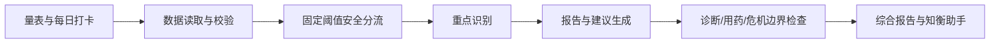

# 知衡

面向普通用户的认知与心理健康随访网页，用标准量表、生活习惯问卷和每日记录帮助用户观察自身变化。

> 本项目用于自我观察和健康教育，不提供疾病诊断、治疗建议或紧急服务。

## 当前功能（v1.0.0）

- WHO-5 心理幸福感评估
- PHQ-9 抑郁症状筛查及第 9 题安全提示
- GAD-7 焦虑症状筛查
- ISI 失眠严重程度评估
- PSS-10 感知压力评估（包含反向计分）
- 生活习惯支持度问卷（非医学量表）
- 情绪、睡眠、压力、精力和运动的每日状态打卡
- 7/30 天统一仪表盘、个人趋势与规则总结
- 匿名记录的 JSON 导出和二次确认删除
- 汇总六类问卷与每日记录的规则化综合报告
- 三条可执行的 7 天建议、专业支持提示和文字报告下载
- LangGraph 五节点智能体：数据读取、安全分流、重点识别、建议组织、输出检查
- 可视化智能体执行轨迹，风险判断始终由确定性规则控制
- 可自由提问的“知衡助手”，能够引用个人记录回答睡眠、压力和情绪问题
- 诊断、用药与危机表达的对话安全分流
- 无需 API 密钥的本地安全回答模式
- 页面内智能体工作流、功能边界和数据控制说明
- 服务端确定性计分、输入校验和自动化测试

## 技术栈

- React 19 + Vinext + TypeScript
- Cloudflare D1 / SQLite + Drizzle ORM
- Cloudflare Workers
- Node.js Test Runner

## 本地运行

```bash
npm install
npm run dev
```

浏览器打开 `http://localhost:3000`。

## 验证

```bash
npm test
```

## 路线图

- [x] 六类自我评估与独立趋势
- [x] 每日状态打卡
- [x] 统一仪表盘与数据管理
- [ ] 简单反应时和数字工作记忆任务
- [x] LangGraph 编排的非诊断性个性化报告
- [x] 基于个人记录的用户追问
- [ ] 可选扩展：配置 API 密钥后的大模型表达层

## 智能体架构



报告智能体由 5 个 LangGraph 节点组成；对话智能体由意图分类、证据提取、回答生成和安全复核 4 个节点组成。v1.0 使用本地确定性规则，不调用外部大模型，因此没有 API 费用，也不会把问答内容发送给模型服务。

## 隐私与安全

当前版本只使用随机匿名标识关联记录，不要求姓名或账号。公开演示中不应使用真实患者或研究参与者资料。在用于真实研究、医疗机构或商业环境前，还需要完成伦理、法律、隐私和临床安全审查。
